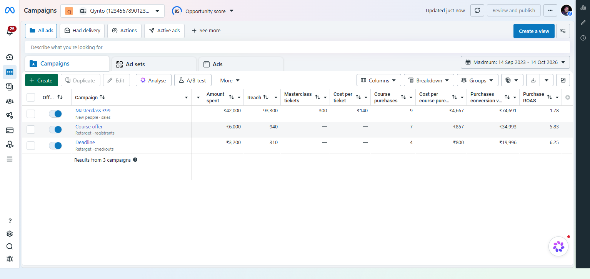
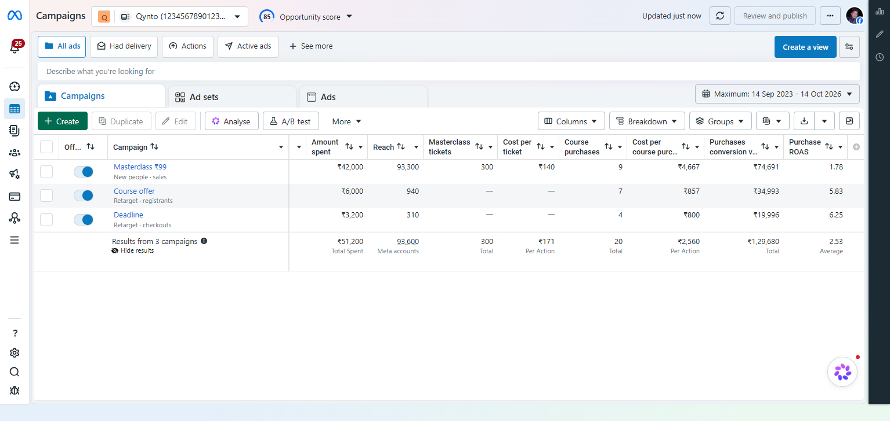
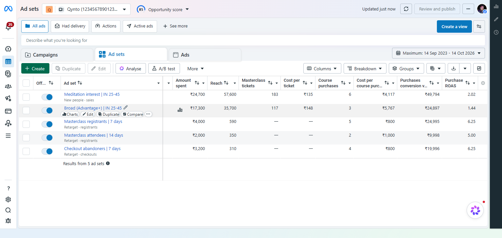

# Facebook Ads Manager Clone

A pixel-matched clone of the **Meta (Facebook) Ads Manager** campaigns screen. It's built with plain **HTML, CSS and JavaScript**: no build step, no Node, no npm.

> [!WARNING]
> **Disclaimer: for learning purposes only.**
> This is a personal study project for practising front-end layout, CSS and JavaScript.
> It is **not** affiliated with, endorsed by, or connected to Meta Platforms, Inc.
> "Facebook", "Meta" and "Ads Manager" are trademarks of Meta Platforms, Inc.
> All data on screen is **fictional sample data**: the campaign names, the numbers, and the account "Qynto" with its ID.
> It does not connect to any real ad account, and it must not be used to impersonate Meta or to collect anyone's information.

---

## Preview

| Campaigns | Campaigns, after "View results" |
|---|---|
|  |  |

| Ad sets (row hovered) | Ads (row hovered) |
|---|---|
|  |  |

---

## What this project achieves

- **A near pixel-perfect copy of a real product screen.** The page was compared region by region (left rail, top bar, view chips, tabs, toolbar, table header, rows, footer, right rail) against real Ads Manager screenshots. Colours, icon shapes, sizes and spacing were then corrected until they matched. This is the main skill the project practises.
- **A working mini dashboard, not just a picture:**
  - **Campaigns → Ad sets → Ads tabs.** Tick campaigns and the other tabs show only their children ("Ad sets for 1 Campaign").
  - **Search** by name, and **view chips**: *All ads*, *Had delivery* (spent > 0), *Active ads* (toggled on).
  - **Sorting:** click any column header.
  - **On/Off toggles.** The *Delivery* column on the Ads tab follows the toggle, and *Review and publish* becomes active after a change.
  - **Footer summary row.** Hover it to see **View results**; click to show live totals, click **Hide results** to hide them again. Totals follow the current filters.
  - **Export** the visible rows to CSV, and **delete** selected rows.
  - Animated **Opportunity score** gauge, "Updated just now / N min ago", and Meta-style thin overlay scrollbars.

---

## Run it locally

The page loads its table data with `fetch()` from JSON files. Browsers block that when a page is opened by double-click (`file://`), so serve the folder with any static server:

- **VS Code:** install the *Live Server* extension, right-click `index.html` and choose **Open with Live Server**.
- **Python:** run `python -m http.server 5500` in this folder, then open <http://127.0.0.1:5500/>.

`sprite-icons.html` is a helper page that shows every icon in the sprite sheet. Click an icon to copy its CSS class.

---

## Project structure

```
index.html          The whole app: HTML layout, CSS (in <style>) and JavaScript (in <script>)
data/
  campaigns.json    Campaign rows + column definitions + totals for the footer
  adsets.json       Ad set rows (each points to its campaign with campaignId)
  ads.json          Ad rows (each points to its ad set and campaign)
icons/              SVG icons for the left rail and toolbar
icon-sprite.webp    Sprite sheet: many small images packed into one file
sprite-icons.html   Browse / copy the icons inside the sprite sheet
thumbs/             Placeholder ad thumbnails
screenshots/        Images used in this README
```

Libraries (loaded from CDNs, so there's nothing to install):

| Library | Used for |
|---|---|
| [Tailwind CSS](https://tailwindcss.com/) (Play CDN) | A few layout utility classes (`flex`, `ml-auto`, `min-w-0`…) |
| [Alpine.js](https://alpinejs.dev/) 3.14 | Reactivity: tabs, selection, search, sorting, toggles, totals |
| Google Fonts: Roboto | Column header labels (Meta uses a Roboto-like face there) |
| Google Fonts: Material Symbols | Two small glyphs (the delete and close icons) |

---

## How the code works

### 1. Page layout (the "app shell")

```
.app (flex row, height: 100vh - 29px)
├── aside.rail          50px white icon rail on the left
├── main                flex column
│   ├── header.topbar   title, account selector, opportunity score, buttons, avatar
│   └── .main-panel     one bordered grey card holding:
│       ├── .views-card     view chips + "Describe what you're looking for" search
│       ├── .tabs-row       Campaigns / Ad sets / Ads tabs + date range button
│       └── .table-card     white card: toolbar + scrollable table + scrollbar strip
└── aside.dark-rail     37px dark rail on the right
```

- **Flexbox** does all the big layout. `flex: 1` and `min-height: 0` let the table card take the remaining space and scroll *inside itself* instead of making the whole page scroll.
- The app stops **29px above the bottom of the window**, like the real product. The soft page gradient shows below it.
- **Colours live in CSS custom properties** (`--ink`, `--link`, `--green`…). Changing one value updates every place that uses it.

### 2. The data model (JSON)

Each tab has its own file. Columns are described in the data, so you can change what the table shows without touching the HTML:

```json
{
  "level": "campaigns", "title": "Campaign", "unit": "campaigns", "total": 3, "nameW": 311,
  "columns": [
    { "key": "spent", "type": "money",  "label": "Amount<br>spent", "w": 106, "totalLabel": "Total Spent" },
    { "key": "roas",  "type": "ratio",  "label": "Purchase<br>ROAS", "w": 110, "totalLabel": "Average" }
  ],
  "totals": { "spent": 51200, "roas": 2.53 },
  "rows": [
    { "id": 1, "active": true, "name": "Masterclass ₹99", "desc": "New people · sales", "spent": 42000, "roas": 1.78 }
  ]
}
```

- `type` decides how a cell is drawn: `money` (₹, no decimals), `number`, `ratio` (2 decimals), or `delivery` (the Active/Off dot).
- `w` is the column width in pixels, and `totalLabel` is the small grey text under the footer total.
- Child rows link to their parents with `campaignId` / `adsetId`. The sample numbers are consistent: each ad set adds up exactly to its campaign.

### 3. State and reactivity with Alpine.js

All the state lives in one object returned by `dashboard()` on `<body x-data="dashboard()">`:

| State | Meaning |
|---|---|
| `tab` | which tab is open |
| `sel` | ticked row ids per tab, e.g. `{ campaigns: [1], adsets: [], ads: [] }` |
| `query`, `view`, `sortKey`, `sortDir` | search text, view chip and sort order |
| `resultsShown` | whether the footer totals are open, per tab |

Everything else is a **getter** (derived state), which Alpine recalculates automatically when its inputs change:

- `filteredByParent`: ad sets of the ticked campaigns, ads of the ticked ad sets.
- `rows`: then applies the search, the view chip and the sort.
- `totals`: footer totals. Amounts and counts are **summed**; cost-per values are **re-calculated from the sums** (`spent ÷ tickets`), and ROAS is `conversion value ÷ spent`. Averaging the per-row ratios would be wrong. For the full list, the file's `totals` are used, because *reach* there is de-duplicated (one person reached by two campaigns counts once).

The HTML only *describes* the view: `x-for` repeats rows, `x-text` fills text, `x-show` hides things, and `:class` toggles classes. There's no manual DOM updating.

### 4. Numbers and money

```js
new Intl.NumberFormat('en-IN', { style: 'currency', currency: 'INR', maximumFractionDigits: 0 }).format(129680)
// → "₹1,29,680"  (Indian lakh grouping)
```

Floating-point maths can turn `6.24875` into `6.2487499…`, which would round down to `6.24`. Ratios are therefore rounded with a tiny nudge: `Math.round(v * 100 + 1e-6) / 100`.

### 5. The table

- **Sticky header and sticky first three columns** (checkbox, on/off, name) use `position: sticky`, with `top` or `left` offsets that equal the widths of the columns before them.
- **`table-layout: fixed`** makes column widths come only from the header cells, so long text can't push columns around. Long labels are cut with an ellipsis, as on the real site.
- **A gotcha worth knowing:** the Tailwind CDN injects its reset CSS *after* our `<style>`, and that reset sets `border-collapse: collapse`. In collapse mode Chrome does not draw the borders of sticky cells, which made some column dividers vanish. The fix is `border-collapse: separate !important`.
- **Row hover** reveals the Meta-style action pills (Charts, Edit, Duplicate, Compare). These pills are absolutely positioned over the lower half of the row, so the row height never changes.
- **Overlay scrollbars:** native scrollbars take up layout space and look different on each OS, so they are hidden. `tableBars()` draws thin grey thumbs instead and keeps them in sync with the real scroll position. It uses a `scroll` listener plus a `ResizeObserver`, and the thumbs can be dragged (`setPointerCapture`).

### 6. Small details that make it feel real

- **Opportunity score gauge:** an SVG circle whose visible arc is controlled by `stroke-dasharray` / `stroke-dashoffset`. A CSS transition sweeps the arc while `requestAnimationFrame` counts the number up with an ease-out curve.
- **Inline SVG icons with `fill="currentColor"`** take the text colour automatically. That's how a chip icon turns blue when the chip is selected.
- **The avatar is a data URI** (the image bytes written inside the HTML), so it needs no extra request.

---

## Single image for many icons: CSS sprites

### The problem

A page with 40 small icons stored as 40 separate files makes **40 separate requests**. Each request has a cost even when the file is tiny:

- request and response headers, sent again every time
- a connection round-trip
- a slot in the browser's download queue

On a slow mobile network those waits add up, and icons pop in one by one.

### The idea

Pack all the icons into **one image**: the *sprite sheet* (`icon-sprite.webp`). The browser downloads it **once**, caches it, and every icon on the page reuses that same cached file.

```
┌───────────────────────────────┐
│ 🌸  ◯  ←  →  ✕  🖥  f  📷 ...   │   one 285×902 image
│ 💬  🪪  👆  ✉️  👁  ...          │
└───────────────────────────────┘
        ▲
        └── each element shows only one small "window" of it
```

### How the CSS cuts one icon out

Each icon class stores where the icon sits in the sheet (`--x`, `--y`), its size (`--w`, `--h`), and its larger side (`--m`). `--s` is the size you want on screen:

```css
.sp-flower-xs { --x:204; --y:885; --w:15; --h:16; --m:16 }

.sp {
  --k: calc(var(--s) / var(--m));                   /* scale factor: wanted size ÷ real size */
  width:  calc(var(--w) * var(--k) * 1px);          /* the element is the "window"           */
  height: calc(var(--h) * var(--k) * 1px);
  background-image: url("icon-sprite.webp");
  background-size: calc(285px * var(--k)) calc(902px * var(--k));            /* scale the whole sheet */
  background-position: calc(var(--x) * var(--k) * -1px) calc(var(--y) * var(--k) * -1px); /* slide it */
}
```

```html
<i class="sp sp-flower-xs s14"></i>   <!-- the flower icon at 14px -->
```

In plain words: **scale the whole sheet, then slide it left and up** so only the wanted icon shows through the element.

### Why it saves time and bandwidth

- **Fewer requests:** 1 instead of N, so fewer round-trips and less header data.
- **Better compression:** one larger image compresses better than many tiny ones, because similar pixels and shared colours are stored once.
- **Instant reuse:** after the first load, every icon, on every page that uses the sheet, comes straight from the browser cache.
- **No pop-in:** all icons appear together.

### Honest trade-offs (worth learning too)

- **A sprite only pays off when you use most of it.** During pixel-matching, most icons here were redrawn as **inline SVG** for exact shapes and colours. The page now uses only a few icons from the sprite, so this 147 KB sheet is bigger than needed. The fix is to rebuild a small sheet that contains only the icons in use.
- **HTTP/2 and HTTP/3** can send many files over one connection at the same time, so the "fewer requests" win is smaller than it used to be. Caching and compression still help.
- **Inline SVG** is often the best choice for UI icons: no request at all, sharp at any size, and recolourable with CSS (`currentColor`).
- **Icon fonts** (like Material Symbols) are convenient but download a whole font for a few glyphs. That's why they're kept to a minimum here.
- **WebP** was used for the sprite and screenshots because it is usually much smaller than PNG at the same quality.

---

## Other front-end concepts practised here

| Concept | Where to look |
|---|---|
| CSS custom properties (design tokens) | `:root { --ink; --link; --green … }` |
| Flexbox app shell, `min-height: 0` for inner scrolling | `.app`, `.main-panel`, `.table-card` |
| `position: sticky` (header, frozen columns, footer) | `th`, `.sticky-col`, `tfoot td` |
| Pseudo-elements for borders and shadows | `.name-edge::after`, `tfoot td::before` |
| `clip-path` to cut a shadow on one side | `.tab.on` |
| Derived state with getters | `rows`, `totals`, `footerCount` in `dashboard()` |
| `fetch` + `Promise.all` to load JSON in parallel | `init()` |
| `Intl.NumberFormat` for currency and grouping | `inr()`, `num()` |
| SVG stroke animation + `requestAnimationFrame` | `gauge()` |
| `ResizeObserver`, pointer capture, passive listeners | `tableBars()` |
| Blob + object URL to download a CSV in the browser | `exportCsv()` |
| WebP images, data URIs, sprite sheets | `icon-sprite.webp`, avatar, `thumbs/` |

---

## How the pixel matching was done

1. Take screenshots of the real screen and of this page, at the same window size.
2. Split the screen into regions and zoom in 3–6× on each one.
3. Measure exact pixel colours, edges and gaps. The real product renders at about **90% zoom**, so many sizes are fractional (rows are 41.5px tall, nav icons 21.6px).
4. Fix the CSS, take a new screenshot, and compare again. The average colour difference per region dropped from roughly 12–33 to about 0–8 (on a 0–255 scale) after the fixes.

---

## Changing the data

Edit the JSON files in `data/` and refresh. Rename rows, change numbers, add rows, or reorder the `columns` array. Keep each ad set's numbers adding up to its campaign so the footer totals stay consistent.

---

*Built for learning. Not affiliated with Meta Platforms, Inc.*
